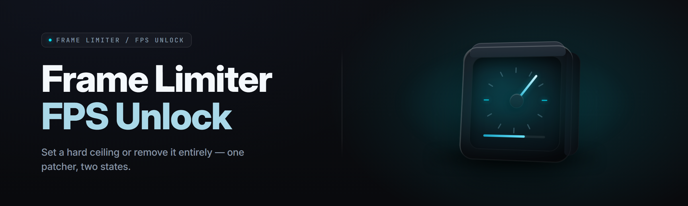

  
  
  

  

  
  
  
  

---

Frame limiter unlock patcher for PC gamers hitting engine FPS caps — set a custom cap, remove vsync ceiling, and keep frame pacing stable.

## Overview

Frame limiter unlock patcher for PC gamers hitting engine FPS caps — set a custom cap, remove vsync ceiling, and keep frame pacing stable.

  

## License

[MIT License](LICENSE)

  

